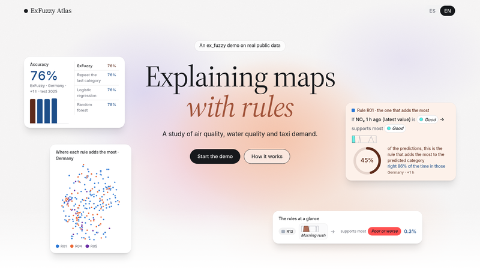
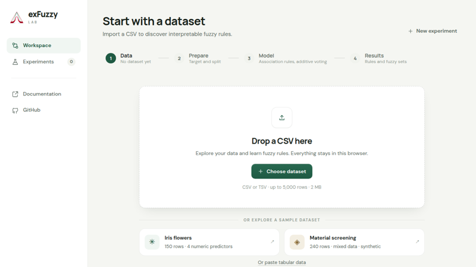
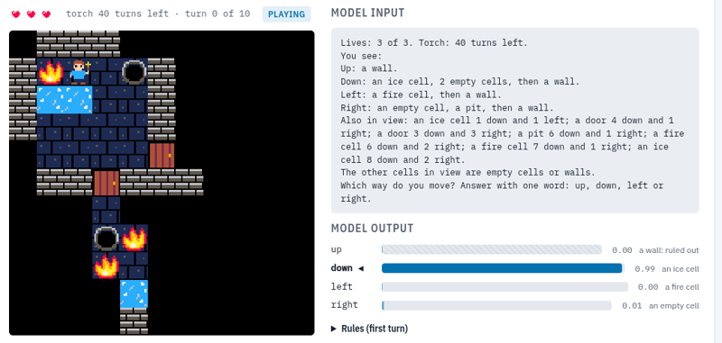

Hi! I am [Postdoc YUFE MSCA fellow](https://www.yufe.eu/early-career-researchers/yufe4postdocs/) in the University of Essex, working in [Prof. Javier Andreu-Perez](https://scholar.google.com/citations?user=1m4DHQQAAAAJ&hl=en)'s research group, researching in Explainable Artificial Intelligence. I did my PhD in the Grupo de Inteligencia y Artificial Razonamiento Aproximado (GIARA) in the Public University of Navarre under the supervision of [Prof. Humberto Bustince](https://scholar.google.com/citations?user=9SI4W2kAAAAJ&hl=en)
and [Prof. Óscar Cordón](https://scholar.google.com/citations?user=oUmv8xgAAAAJ&hl=en). During my PhD I also was a visiting researcher in the University of Essex, under the supervision of [Prof Hani Hagras](https://scholar.google.com/citations?user=ByclDBUAAAAJ&hl=en).

#### What I work on

- **Interpretable models.** Rule-based classifiers whose IF-THEN rules people can read and check, built on fuzzy logic. I maintain [Ex-Fuzzy](/software/), a Python library for them.
- **Reliable predictions.** Models that say how sure they are, and abstain or ask for more information when they are not: conformal prediction, interval-valued fuzzy sets and dynamic feature selection.
- **What LLMs believe.** How large language models update their beliefs about a problem as evidence arrives, how far that is from a Bayesian observer, and when they break the rules they are given.

#### Try it in your browser

  

    
    
<a href="https://fuminides.github.io/exfuzzy-atlas/"><strong>ExFuzzy Atlas</strong></a>: fuzzy rules learned with Ex-Fuzzy on air quality, river water and New York taxi data, and where on the map each rule decides.

  

  

    
    
<a href="https://fuminides.github.io/exfuzzy-lab/"><strong>Ex-Fuzzy Lab</strong></a>: upload a dataset, learn fuzzy rules with Ex-Fuzzy and explore them, with nothing to install.

  

  

    
    
<a href="https://fuminides.github.io/llm-belief-jepa/"><strong>What does the model think it knows?</strong></a>: watch LLMs play a clue game and a text dungeon, turn by turn, against the Bayesian answer.

  

#### Thesis topics

I supervise BSc and MSc projects. Some topics I would like to work on with students, though your own ideas are welcome too:

- **Models that know when to abstain, or when to ask for more information.** Classifiers that refuse to answer when the evidence is weak, or that pick, case by case, the next measurement worth taking and stop as soon as they are confident enough, without spending more than they need.
- **Do vision concepts mean what we think?** Checking whether the concepts detected by concept bottleneck models are reliable, and what happens to the explanation when they are not.
- **LLM safety.** Probing language models to understand the uncertainty they manage about a problem, and how that uncertainty affects their behaviour, for example when they break the rules they are given.
- **Extending Ex-Fuzzy.** New learning algorithms, visualisations or applications for the library and its browser lab.

If one of these sounds interesting, [send me an email](mailto:j.fumanal-idocin@essex.ac.uk).

Besides science, my personal interests include playing the piano and the guitar, reading lots about ancient history and MTG. My (now) favourite book is La Batalla en el Fin del Mundo, by Mario Vargas Llosa.

Looking to collaborate? I am always open to hear about new ideas! Just feel free to send me an email.
