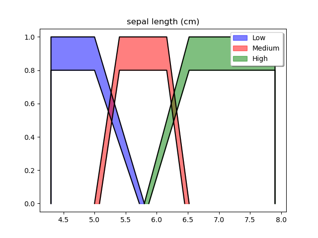
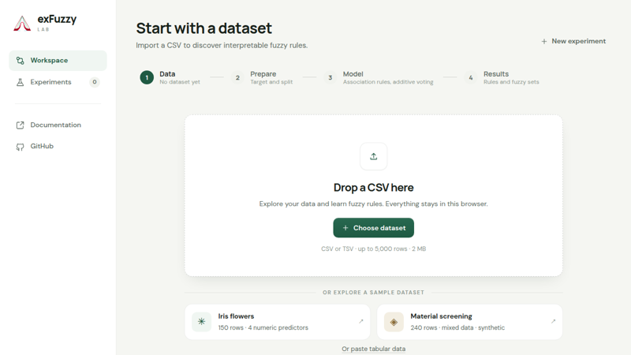
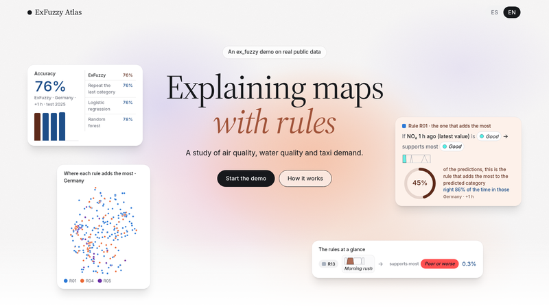

## Ex-Fuzzy

<p>
  <a href="https://github.com/Fuminides/ex-fuzzy"></a>
  <a href="https://pypi.org/project/ex-fuzzy/"></a>
  <a href="https://pepy.tech/projects/ex-fuzzy"></a>
</p>

<div class="row">
  <div class="col-md-7">
    <p><strong>Ex-Fuzzy</strong> is a modern Python library for building explainable rule-based models using fuzzy logic. It provides comprehensive capabilities for model visualization and validation. It is also designed with ease of use in mind, so that users shall find here a scikit learn compatible interface, with no previous fuzzy logic knowledge required to run the models.</p>
  </div>
  <div class="col-md-5">
    
    <p class="text-muted small mt-1">The fuzzy sets Low, Medium and High that Ex-Fuzzy uses for one variable of the Iris dataset.</p>
  </div>
</div>

<div class="row align-items-center mt-3 mb-4 mx-0 p-3 rounded" style="background: var(--global-code-bg-color);">
  <div class="col-sm-4 mb-2 mb-sm-0 px-0 pr-sm-3">
    <a href="https://fuminides.github.io/exfuzzy-lab/"></a>
  </div>
  <div class="col-sm-8 px-0">
    <strong>Try it in your browser.</strong> <a href="https://fuminides.github.io/exfuzzy-lab/">Ex-Fuzzy Lab</a> is a visual workspace where you can upload your own dataset, run real Ex-Fuzzy experiments and explore the rules behind the results, with nothing to install.
  </div>
</div>

<div class="row align-items-center mt-3 mb-4 mx-0 p-3 rounded" style="background: var(--global-code-bg-color);">
  <div class="col-sm-4 mb-2 mb-sm-0 px-0 pr-sm-3">
    <a href="https://fuminides.github.io/exfuzzy-atlas/"></a>
  </div>
  <div class="col-sm-8 px-0">
    <strong>See it on real data.</strong> <a href="https://fuminides.github.io/exfuzzy-atlas/">ExFuzzy Atlas</a> shows Ex-Fuzzy models on public data: NO<sub>2</sub> air quality in Germany, dissolved oxygen in the Northumberland and Tyne rivers, and yellow-taxi demand in New York. You can read each rule, see where on the map it decides, and compare the models with simple baselines. The source is on <a href="https://github.com/Fuminides/exfuzzy-atlas">GitHub</a>.
  </div>
</div>

### Key Features

- **Explainable AI**: Create interpretable models using fuzzy association rules that humans can understand and verify
- **Rich Visualizations**: Built-in tools for visualizing fuzzy sets, membership functions, and rule bases
- **Scikit-learn Compatible**: Follows the scikit-learn API for seamless integration with existing ML pipelines
- **High Performance**: Optional GPU support for computationally intensive tasks
- **Comprehensive Support**: Classification, regression, and rule mining capabilities

### Installation

```bash
pip install ex-fuzzy
```

### Quick Example

```python
from ex_fuzzy import evolutionary_fit as gfs
from ex_fuzzy import utils

# Load your data
X_train, y_train, X_test, y_test = utils.load_data()

# Create and train a fuzzy classifier
fuzzy_clf = gfs.FuzzyRulesClassifier()
fuzzy_clf.fit(X_train, y_train)

# Get interpretable rules
print(fuzzy_clf.print_rules())

# Make predictions
predictions = fuzzy_clf.predict(X_test)
```

### Links

<div class="repositories d-flex flex-wrap flex-md-row flex-column justify-content-between align-items-center">
  <div class="repo p-2">
    <a href="https://github.com/Fuminides/ex-fuzzy">
      <i class="fab fa-github"></i> GitHub Repository
    </a>
  </div>
  <div class="repo p-2">
    <a href="https://fuminides.github.io/ex-fuzzy/">
      <i class="fas fa-book"></i> Documentation
    </a>
  </div>
  <div class="repo p-2">
    <a href="https://pypi.org/project/ex-fuzzy/">
      <i class="fab fa-python"></i> PyPI Package
    </a>
  </div>
</div>

---

### Papers Using Ex-Fuzzy

#### Core Library Paper

**Ex-Fuzzy: A Library for Symbolic Explainable AI Through Fuzzy Logic Programming** (Neurocomputing, 2024)
_Fumanal-Idocin & Andreu-Perez_
The foundational paper describing the library's architecture, capabilities, and design philosophy. Introduces the scikit-learn compatible API and visualization tools.

---

#### Additional Functionalities Implemented in Ex-Fuzzy

**A Fast Interpretable Fuzzy Tree Learner** (arXiv, 2025)
_Fumanal-Idocin, Fernandez-Peralta & Andreu-Perez_
Introduces a novel fuzzy decision tree algorithm optimized for speed and interpretability. The implementation is available in Ex-Fuzzy as an alternative to rule-based classifiers in its own repository. Still WIP to bring it to the full library.

**Reliable Classification with Conformal Learning and Interval-Type 2 Fuzzy Sets** (FUZZ-IEEE, 2025)
_Fumanal-Idocin & Andreu-Perez_
Combines conformal prediction with Interval Type-2 fuzzy sets for uncertainty-aware classification. Extends Ex-Fuzzy's IT2 capabilities with reliability guarantees. Still WIP to bring it to the full library.

---

#### (Some) Papers Using Ex-Fuzzy

**Compact Rule-Based Classifier Learning via Gradient Descent** (arXiv, 2025)
_Fumanal-Idocin, Fernandez-Peralta & Andreu-Perez_

**ArtXAI: Explainable Artificial Intelligence Curates Deep Representation Learning for Artistic Images Using Fuzzy Techniques** (IEEE Trans. Fuzzy Systems, 2023)
_Fumanal-Idocin, Andreu-Perez, Cordón, Hagras & Bustince_
Uses Ex-Fuzzy to provide explainable classification of artistic images by learning fuzzy rules over deep learning embeddings. Demonstrates how fuzzy rules can interpret neural network representations.

**Interpreting Contrastive Embeddings in Specific Domains with Fuzzy Rules** (FUZZ-IEEE, 2024)
_Fumanal-Idocin, Jamalifard & Andreu-Perez_
Applies Ex-Fuzzy to interpret contrastive learning embeddings (e.g., CLIP) using domain-specific fuzzy rules, bridging black-box representations with human-understandable concepts.

**Efficient Online Generation of Fuzzy Measures via Aggregation Functions** (Information Fusion, 2026)
_Gonzalez-Garcia, Horanská, Beliakov & Bustince_

**Crisp Complexity of Fuzzy Classifiers** (FUZZ-IEEE, 2025)
_Fernandez-Peralta, Fumanal-Idocin & Andreu-Perez_
Proposes new complexity metrics for fuzzy classifiers. Uses Ex-Fuzzy to empirically study the relationship between rule complexity and model performance.

---

### News and Updates

- **2026**: [Ex-Fuzzy 3.1.1](https://pypi.org/project/ex-fuzzy/) released: up to 20x faster than 2.X versions, significant accuracy improvements in rule-based methods, and state-of-the-art results among interpretable classifiers with compact rule bases
- **2026**: Regression support, GPU acceleration, and [FERL](https://arxiv.org/abs/2608.05859) (Fast Evidential Rule Learning) added, with Dempster-Shafer reasoning, out-of-distribution detection, and abstention
- **2025**: Evox with GPU support added. Massive speedups in genetic optimization as well.
- **2025**: Three papers accepted at FUZZ-IEEE 2025 using Ex-Fuzzy
- **2024**: Ex-Fuzzy 2.0 released with improved performance and new features
- **2024**: Core library paper published in [Neurocomputing](https://doi.org/10.1016/j.neucom.2024.128048)
- **2023**: ArtXAI paper published in IEEE Trans. Fuzzy Systems
- **2023**: Initial public release on PyPI

---

### Citation

If you use Ex-Fuzzy in your research, please cite:

```bibtex
@article{FUMANALIDOCIN2024128048,
  title = {Ex-Fuzzy: A library for symbolic explainable AI through fuzzy logic programming},
  journal = {Neurocomputing},
  pages = {128048},
  year = {2024},
  author = {Javier Fumanal-Idocin and Javier Andreu-Perez},
  doi = {https://doi.org/10.1016/j.neucom.2024.128048}
}
```

---

### Contributing

Ex-Fuzzy is open source under the AGPL v3 license. Contributions, bug reports, and feature requests are welcome on [GitHub](https://github.com/Fuminides/ex-fuzzy/issues).

If you are a BSc/MSc student looking for thesis projects, I am actively supervising work on extending Ex-Fuzzy functionalities and doing more research with the tool. There are more [thesis topics](/#thesis-topics) on the home page. Feel free to [contact me](mailto:j.fumanal-idocin@essex.ac.uk).
