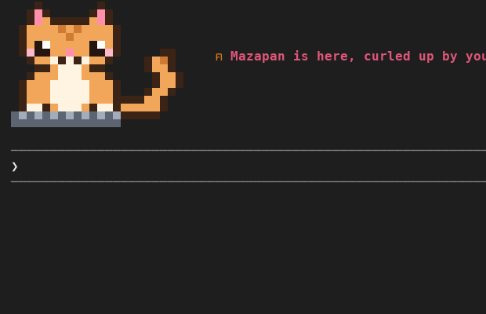
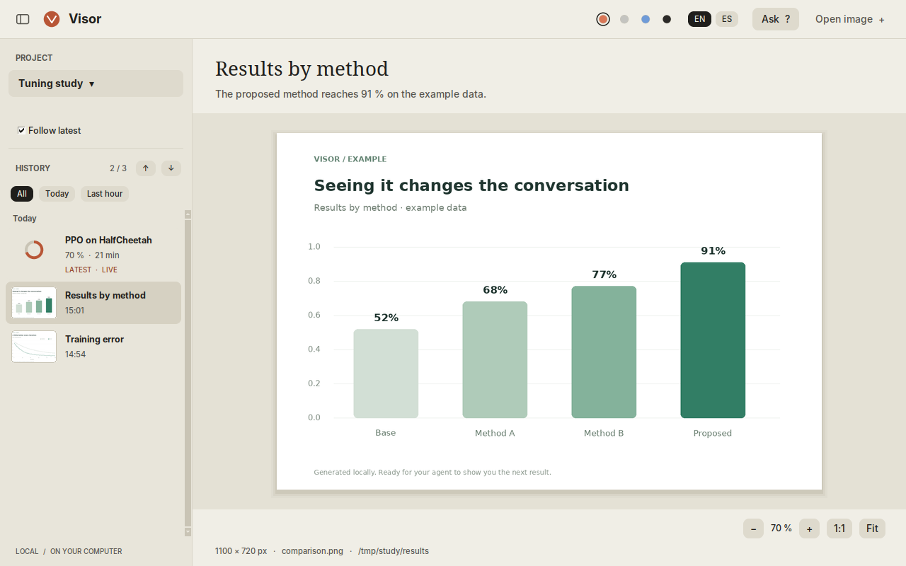
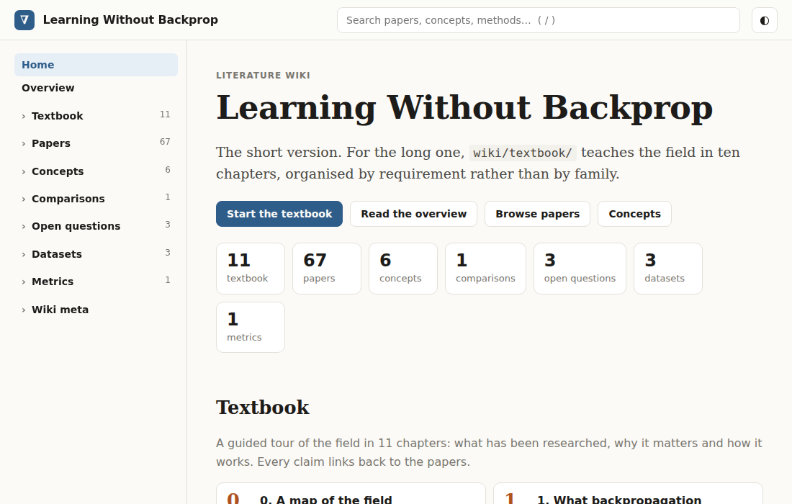

## Tools & mods

  

    
  

  

    <h3>cute-claude</h3>
    
A Claude Code plugin that gives the terminal a look: a ginger cat, a wizard hamster, an illuminated manuscript, a tech-priest of the Adeptus Mechanicus, or Cortana. Each look adds an animated figure above the prompt, a motto in the status line and a light flavour to Claude's wording, and some offer full role-play. Technical details stay exact either way.

    
<code>claude plugin install cute-claude --marketplace Fuminides/cute-claude</code>

    <a href="https://github.com/Fuminides/cute-claude"><i class="fab fa-github"></i> GitHub Repository</a>
  

  

    
  

  

    <h3>Visor</h3>
    
A small desktop window where Codex and Claude Code show you plots, images and PDF slide decks while they work from the terminal, together with the skill that tells the agent when to use it. It keeps a history of every version of a figure, follows a file as the agent regenerates it, and has a panel to ask the session that made a figure about it: right-click a point and the question carries a zoomed crop of that spot. It runs locally, with no network ports or API keys.

    <a href="https://github.com/Fuminides/agent-visor"><i class="fab fa-github"></i> GitHub Repository</a>
  

---

## Skills for LLM agents

  

    
  

  

    <h3>Literature Wiki</h3>
    
A skill for Codex and Claude Code that turns a curated set of research papers into a source-grounded wiki: it helps collect open-access PDFs, analyses each paper, writes cross-paper synthesis pages and a short textbook, checks that every claim points to a passage in a source, and builds an offline static site with search and KaTeX math. Five slash commands cover the usual steps: <code>/create-wiki</code>, <code>/add-papers</code>, <code>/update-wiki</code>, <code>/wiki-exams</code> and <code>/serve-wiki</code>.

    <a href="https://github.com/Fuminides/literature-wiki-skill"><i class="fab fa-github"></i> GitHub Repository</a>
  

  

    <h3>Astra + Opus</h3>
    
A Codex skill that lets Astra act as a coordinator and hand substantial work to Claude Opus through two wrapper scripts: a worker that implements changes, and a read-only consultant for debugging and independent review. Astra keeps the planning, integration and final checks. The aim is to spend fewer Astra tokens without losing quality, so the skill also says when delegating is not worth the briefing cost.

    <a href="https://github.com/Fuminides/opus-delegate"><i class="fab fa-github"></i> GitHub Repository</a>
  

